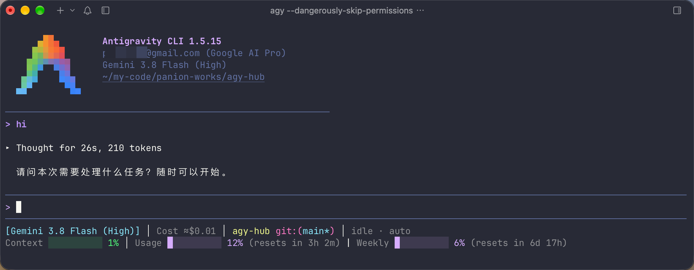

# AGY HUD

[简体中文](README.zh.md)

[](https://github.com/JS-banana/agy-hud/actions/workflows/test.yml)
[](package.json)
[](LICENSE)

AGY HUD is a configurable terminal status line for the Antigravity CLI (`agy`). It keeps your active model, context usage, quota reset countdowns, session cost, Git/Jujutsu status, and live tool/subagent activity visible at a glance—and adapts automatically to narrow terminals.



## Features

- **Context & quota**: Live usage bars with warning thresholds, plus 5-hour and weekly quota reset countdowns.
- **Cost & tokens**: Session cost with local standard API rate estimates (`≈$x.xx`) when omitted, plus optional daily/weekly totals and cache stats.
- **Tools & subagents**: Real-time running and completed tools, Skills, MCP calls, and subagent status.
- **Model & VCS**: Active model, agent mode, Git branch and change stats, plus optional Jujutsu (`jj`) support.
- **Lightweight & reversible**: Narrow-terminal adaptation, EN/ZH labels, zero runtime dependencies on Node.js 22+, automatic backup, and one-command undo/uninstall.

## Layouts

Three built-in presets cover common terminal sizes (tested below with `node src/cli.js preview --preset <name> --plain`):

**`default`** — two-row view with model, project, Git, context, and quota:

```text
[Gemini 3.8 Flash ◑ high] │ my-project git:(main*)
Context █████░░░░░ 45% │ Usage ███░░░░░░░ 25% (resets in 1h 30m)
```

**`compact`** — fits project and metrics onto one line when width allows:

```text
[Gemini 3.8 Flash ◑ high] █████░░░░░ 45% | my-project git:(main*) | Usage ███░░░░░░░ 25% (1h 30m / 5h)
```

**`activity`** — adds a divider with live tool calls and subagent status:

```text
[Gemini 3.8 Flash ◑ high] │ my-project git:(main*)
Context █████░░░░░ 45% │ Usage ███░░░░░░░ 25% (resets in 1h 30m)
────────────────────────────────────────────────────────────────
◐ Edit: auth.ts | ✓ Read ×3 | ✓ Grep ×2
◐ explore [Gemini Flash]: Finding auth code
```

On narrow terminals, bars shorten and rows wrap automatically (`node src/cli.js preview --width 60 --plain` to test).

## Quick Start

Requires **macOS or Linux**, **Node.js 22+**, and an **`agy` version that supports custom status lines**. Keep the local checkout at a stable path because `agy` invokes it by absolute path.

### Option 1: Ask your coding agent (Recommended)

Send this prompt to your coding agent:

```text
Set up AGY HUD for my Antigravity CLI following skills/agy-hud/SKILL.md in https://github.com/JS-banana/agy-hud. Preview the HUD before enabling it and register /agy-hud.
```

If `/agy-hud` is already installed, run:

```text
/agy-hud Install the HUD and show me the preview first
```

### Option 2: Interactive terminal wizard

```sh
mkdir -p "$HOME/.local/share"
git clone https://github.com/JS-banana/agy-hud.git "$HOME/.local/share/agy-hud"
cd "$HOME/.local/share/agy-hud"
node src/cli.js setup
```

The wizard lets you preview layouts and toggle options before applying, backs up any existing status line after confirming replacement, and takes effect in your next `agy` session.

**Try for one session without installing:**

```sh
agy --settings "$(node src/cli.js settings)"
```

## Customize

Once `/agy-hud` is loaded, ask for changes in plain language from any workspace:

```text
/agy-hud Enable cost estimates, always show weekly quota, and show tools and subagents
```

Or adjust from the terminal using the wizard (`node src/cli.js setup --configure-only`) or CLI:

```sh
node src/cli.js config show
node src/cli.js config set '{"display":{"showCost":true,"sevenDayThreshold":0,"showTools":true}}'
node src/cli.js config undo
```

Commonly tuned options:

| Setting | Default | What it controls |
| --- | --- | --- |
| `lineLayout` | `"expanded"` | `"expanded"` (multi-row) or `"compact"` (single-row when space fits) |
| `language` | `"en"` | HUD labels: `"en"`, `"zh-Hans"`, or `"zh-Hant"` |
| `display.showCost` | `false` | Show session cost, estimating locally (`≈$x.xx`) when `agy` omits it |
| `display.showTools` / `showAgents` | `false` | Show live/completed tools and running/finished subagents |
| `display.sevenDayThreshold` | `80` | 5h usage % at which weekly quota appears (`0` shows whenever available) |
| `gitStatus.showFileStats` | `false` | Show changed file counts and line diffs next to the Git branch |
| `display.customLine` | `""` | Custom text on the project row, e.g. `⚡ ship it`; color via `colors.custom`, order via `"custom"` in `projectLineOrder` |

See [Configuration reference](docs/configuration.md) for all options, colors, JSON Schema setup, and environment variables, and [Antigravity integration](docs/integration.md) for data sources, API cost rates, and optional hooks.

## Diagnostics, Upgrade & Uninstall

- **Check & replay**: Run `node src/cli.js doctor` (or `/agy-hud doctor`) to verify bindings and config, `node src/cli.js report` for an anonymized diagnostic summary, or `node src/cli.js preview --last` to replay the last recorded frame.
- **Upgrade**: Pull updates and refresh bindings from your AGY HUD directory:
  ```sh
  git pull --ff-only
  node src/cli.js install
  node src/cli.js skill install # if using /agy-hud
  ```
- **Temporary disable**: Run `AGY_HUD_DISABLE=1 agy`.
- **Uninstall**: Restore your previous status line configuration:
  ```sh
  node src/cli.js skill uninstall # if installed
  node src/cli.js uninstall
  ```

## Development & License

```sh
npm ci
npm run check
```

[Contributing](CONTRIBUTING.md) · [Changelog](CHANGELOG.md) · [Architecture](docs/architecture.md) · [MIT License](LICENSE)

## Acknowledgements

AGY HUD draws inspiration from [claude-hud](https://github.com/jarrodwatts/claude-hud). Thanks to its author and contributors.
