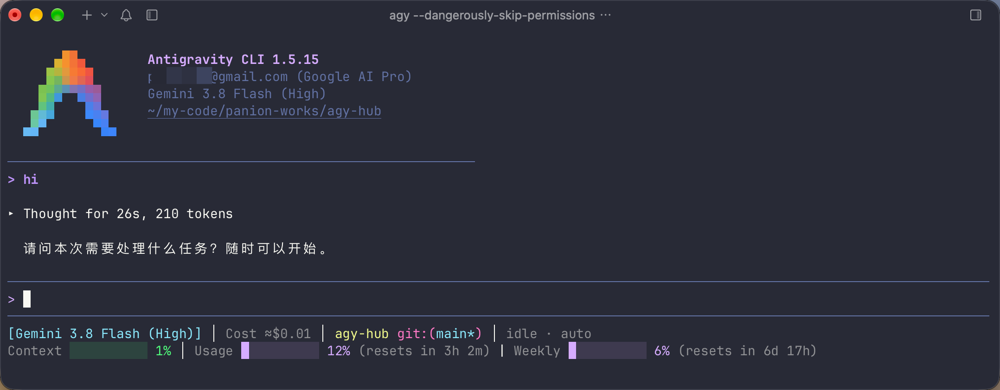

# AGY HUD

[English](README.md)

[](https://github.com/JS-banana/agy-hud/actions/workflows/test.yml)
[](package.json)
[](LICENSE)

AGY HUD 是为 Antigravity CLI（`agy`）打造的可配置终端状态栏。它能在一屏之内直观呈现当前模型、上下文占用、配额与重置倒计时、会话金额、Git/Jujutsu 状态以及实时工具与子代理调用，并在窄屏终端下自动调整布局。



## 核心功能

- **上下文与配额**：实时进度条、阈值变色提醒、5 小时与周配额及重置倒计时。
- **费用与 Token**：展示会话金额（缺省时按标准 API 费率本地估算 `≈$x.xx`），可选日/周费用与缓存命中率。
- **工具与子代理**：追踪运行中与已完成的工具、Skills、MCP 及子代理状态。
- **模型与版本控制**：显示当前模型、运行模式、Git 分支与变更状态，可选支持 Jujutsu（`jj`）。
- **轻量可回退**：窄屏自适应、支持中英文、Node.js 22+ 零依赖，自动备份原配置且支持一键 `undo` / 卸载。

## 布局预览

内置三种布局预设以适配不同终端宽度（以下为 `node src/cli.js preview --preset <name> --plain` 实际输出）：

**`default`** —— 默认两行，均衡展示模型、项目、Git、上下文和配额：

```text
[Gemini 3.8 Flash ◑ high] │ my-project git:(main*)
Context █████░░░░░ 45% │ Usage ███░░░░░░░ 25% (resets in 1h 30m)
```

**`compact`** —— 紧凑单行，空间充足时将项目与主要指标合并到一行：

```text
[Gemini 3.8 Flash ◑ high] █████░░░░░ 45% | my-project git:(main*) | Usage ███░░░░░░░ 25% (1h 30m / 5h)
```

**`activity`** —— 扩展活动视图，在分隔线下实时展示工具调用与子代理状态：

```text
[Gemini 3.8 Flash ◑ high] │ my-project git:(main*)
Context █████░░░░░ 45% │ Usage ███░░░░░░░ 25% (resets in 1h 30m)
────────────────────────────────────────────────────────────────
◐ Edit: auth.ts | ✓ Read ×3 | ✓ Grep ×2
◐ explore [Gemini Flash]: Finding auth code
```

在较窄的终端窗口中，进度条会自动缩短并智能折行（可通过 `node src/cli.js preview --width 60 --plain` 预览效果）。

## 快速开始

环境要求：**macOS 或 Linux**、**Node.js 22+**，以及支持自定义状态栏的 **`agy`**。由于 `agy` 会按绝对路径调用状态栏脚本，请将代码保存在固定目录中。

### 方式一：让编程 Agent 帮你接入（推荐）

复制以下提示词发给你的 Agent：

```text
帮我按 https://github.com/JS-banana/agy-hud 中 skills/agy-hud/SKILL.md 的指引接入 Antigravity CLI 状态栏，先预览再启用，并注册 /agy-hud。
```

如果你已经加载过 `/agy-hud` 技能，直接输入：

```text
/agy-hud 帮我接入 AGY HUD，先给我看预览
```

### 方式二：终端交互向导手动安装

```sh
mkdir -p "$HOME/.local/share"
git clone https://github.com/JS-banana/agy-hud.git "$HOME/.local/share/agy-hud"
cd "$HOME/.local/share/agy-hud"
node src/cli.js setup --prompt-language zh-Hans
```

向导会先预览效果、由你选择要开启的信息；若检测到已有状态栏配置，会在确认后自动备份再替换。设置完成后，新开一个 `agy` 会话即可生效。

**单次会话免安装试用：**

```sh
agy --settings "$(node src/cli.js settings)"
```

## 常用定制

注册 `/agy-hud` 后，在任何工作区都可以直接用自然语言调整状态栏：

```text
/agy-hud 帮我开启费用估算、常驻周配额和工具活动，界面改成简体中文
```

也可以在终端里重新打开配置向导（`node src/cli.js setup --configure-only --prompt-language zh-Hans`），或通过 CLI 直接修改与撤回：

```sh
node src/cli.js config show
node src/cli.js config set '{"language":"zh-Hans","display":{"showCost":true,"sevenDayThreshold":0,"showTools":true}}'
node src/cli.js config undo
```

最常调整的配置项：

| 配置项 | 默认值 | 作用 |
| --- | --- | --- |
| `lineLayout` | `"expanded"` | 布局模式：`"expanded"`（多行展开）或 `"compact"`（紧凑单行） |
| `language` | `"en"` | 标签语言：`"en"`、`"zh-Hans"`（简体中文）或 `"zh-Hant"`（繁体中文） |
| `display.showCost` | `false` | 显示会话费用；`agy` 缺省时自动按标准 API 费率估算并标注 `≈` |
| `display.showTools` / `showAgents` | `false` | 实时显示工具调用计数与子代理状态 |
| `display.sevenDayThreshold` | `80` | 5 小时配额达到多少百分比时显示周配额；设为 `0` 则有数据就常驻显示 |
| `gitStatus.showFileStats` | `false` | 在分支旁显示变更文件数或增删行数 |
| `display.customLine` | `""` | 在项目行显示自定义文字，如 `⚡阳光彩虹小白马`；颜色由 `colors.custom` 控制，位置可通过 `projectLineOrder` 中的 `"custom"` 排序 |

完整配置项、配色、JSON Schema 与环境变量见 [完整配置参考](docs/configuration.md)；数据来源、API 费率与可选 Hooks 见 [Antigravity 集成指南](docs/integration.md)。

## 排查、升级与卸载

- **健康检查与回放**：在项目目录运行 `node src/cli.js doctor`（或发送 `/agy-hud 帮我检查状态栏`）检查绑定与配置；`node src/cli.js report` 可生成脱敏诊断报告；启用 `display.recordPreview` 后可用 `node src/cli.js preview --last` 回放上一帧。
- **升级版本**：
  ```sh
  git pull --ff-only
  node src/cli.js install
  node src/cli.js skill install # 若使用了 /agy-hud
  ```
- **临时停用**：运行 `AGY_HUD_DISABLE=1 agy` 启动单次会话。
- **彻底卸载**：移除技能并恢复原有的状态栏配置：
  ```sh
  node src/cli.js skill uninstall # 若安装了 Skill
  node src/cli.js uninstall
  ```

## 开发与许可

```sh
npm ci
npm run check
```

[贡献指南](CONTRIBUTING.md) · [更新日志](CHANGELOG.md) · [工程架构](docs/architecture.md) · [MIT 许可证](LICENSE)

## 致谢

AGY HUD 的设计参考了 [claude-hud](https://github.com/jarrodwatts/claude-hud)，感谢其作者与贡献者。
