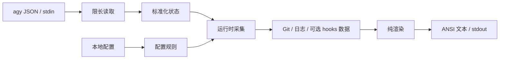

# 工程架构

AGY Hub 是 Antigravity CLI 的 statusline 命令。AGY 每次调用提供一个 JSON 对象，HUD 输出一帧。npm 包直接运行 ESM JavaScript。开发时通过 JSDoc 描述模块接口，带 `@ts-check` 的模块启用 TypeScript 严格检查。

## 配置

[`src/config-schema.js`](../src/config-schema.js) 定义配置字段、默认值和约束。同一套规则负责运行时归一化、`config check` 诊断与编辑器 JSON Schema。运行时用默认值补齐无效或缺失的设置。`init` 写入稀疏预设，之后新增的默认值可自动生效。

[`src/preferences.js`](../src/preferences.js) 负责 HUD 配置的检查、预览、写入和一步撤销。[`src/setup.js`](../src/setup.js) 规划、备份和恢复 AGY 的 `statusLine` 条目。[`src/setup-command.js`](../src/setup-command.js) 协调两个操作，终端向导和本地 Skill 共用这条命令入口与配置校验。启用绑定时先锁定 AGY 设置并检查拟写文件，再保存 HUD 配置。绑定提交失败时，用写入前的内容回滚本次配置改动，保留外部编辑。

## 模块边界

- [`src/cli.js`](../src/cli.js) 是稳定的命令入口。有参数时处理预览、配置、诊断、安装等命令；状态栏回调由 [`src/runtime/statusline.js`](../src/runtime/statusline.js) 采集数据。
- [`src/state.js`](../src/state.js) 将 AGY 的不可信 JSON 变成 HUD 状态。缺失字段保持缺失。文件和标准输入有体积限制。
- [`src/render.js`](../src/render.js) 组装画面，[布局](../src/render/layout.js) 只做行合并和列宽计算，[项目区](../src/render/project.js) 负责项目路径与版本控制显示。渲染代码和标准化代码可用固定输入直接测试。
- 运行时调用 Git、日志、hooks、费用和预览模块。[`src/runtime/json-file.js`](../src/runtime/json-file.js) 提供有界的本地 JSON 读取与原子文件替换。[`src/cost.js`](../src/cost.js) 单独维护费用账本和归档。渲染层接收整理后的数据，依赖测试检查其可达模块是否引入 I/O 依赖。

## 验证与调试

运行 `npm run check` 执行类型检查、行为测试和打包验收。打包验收在临时 HOME 和两个 npm 前缀中安装发行包，验证真实 shell 命令能从 stdin 渲染、旧入口失效后能重新绑定，以及卸载能还原原状态栏。GitHub CI 配置在 macOS 和 Linux 上跑 Node.js 22 与 24，其中 macOS Node.js 24 任务安装真实的 `jj`。

新增配置时同时确认默认值、写入校验和实际渲染。调整终端输出时检查默认布局、窄屏和无色输出。AGY 输入字段与 hooks 的实际来源和验证范围见 [Antigravity 集成](integration.md)。
