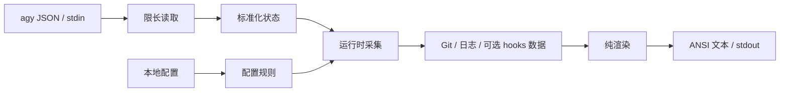

# 工程架构

AGY Hub 是 Antigravity CLI 的 statusline 命令。AGY 每次调用提供一个 JSON 对象，HUD 输出一次状态栏画面。npm 包直接运行 ESM JavaScript；开发时用 TypeScript 对带 JSDoc 的配置、状态和渲染接口作严格检查。

## 配置

[`src/config-schema.js`](../src/config-schema.js) 是默认值、类型、约束和字段说明的来源。同一规则生成有效配置、`config check` 的诊断和编辑器 JSON Schema。状态栏读取异常时使用默认值；显式检查或修改会指出有问题的字段。`init` 只保存预设的差异项，之后新增的默认值会自然生效。

设置修改采用原子替换并保留一步撤销记录。安装只替换 AGY 的 `statusLine` 条目，备份原配置值；卸载按当前命令归属决定是否还原。

终端向导收集改动并展示示例，确认前没有写入。Agent 可使用同一个 `setup` 的 `--dry-run` 和 `--yes` 流程。预览与保存复用同一配置校验。可选的 Antigravity 本地 Skill 只描述这些 CLI 命令的使用流程。

## 模块边界

- [`src/cli.js`](../src/cli.js) 是稳定的命令入口。有参数时处理预览、配置、诊断、安装等命令；状态栏回调由 [`src/runtime/statusline.js`](../src/runtime/statusline.js) 采集数据。
- [`src/state.js`](../src/state.js) 将 AGY 的不可信 JSON 变成 HUD 状态。缺失字段保持缺失。文件和标准输入有体积限制。
- [`src/render.js`](../src/render.js) 组装画面，[布局](../src/render/layout.js) 只做行合并和列宽计算，[项目区](../src/render/project.js) 负责项目路径与版本控制显示。渲染代码和标准化代码可用固定输入直接测试。
- Git、日志、hooks、费用快照和预览缓存由运行时读取。渲染层的依赖检查会拒绝文件系统、子进程和网络模块。操作系统权限由运行 HUD 的账户决定。

## 验证与调试

运行 `npm run check` 执行类型检查、行为测试和打包验收。打包验收在临时 HOME 和两个 npm 前缀中安装发行包，验证真实 shell 命令能从 stdin 渲染、旧入口失效后能重新绑定，以及卸载能还原原状态栏。GitHub CI 配置在 macOS 和 Linux 上跑 Node.js 22 与 24。

新增配置应同时校验用户输入、确认默认值、更新相应渲染路径。调整终端输出时，核对默认布局、窄屏和无颜色模式。涉及 AGY 新输入字段或 hooks 时，按 [功能对照](parity.md) 记录实际数据来源与运行证据。
