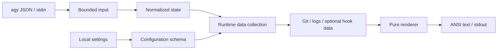

# Architecture

AGY Hub is a status line command for the Antigravity CLI. Each invocation receives a JSON object and returns one rendered frame. Both the source checkout and unpacked release run directly on Node.js as ESM JavaScript. JSDoc describes module interfaces, and modules with `@ts-check` use TypeScript's strict checks.

## Configuration

[`src/config-schema.js`](../src/config-schema.js) defines settings, defaults, and constraints. The schema also powers runtime normalization, `config check`, and editor JSON Schema generation. Runtime configuration uses defaults for missing or invalid values. `init` writes a sparse preset so future defaults can take effect without migrating the file.

[`src/preferences.js`](../src/preferences.js) validates, previews, saves, and undoes HUD configuration changes. [`src/setup.js`](../src/setup.js) plans, backs up, and restores the Antigravity `statusLine` binding. [`src/setup-command.js`](../src/setup-command.js) coordinates both operations. The wizard and local skill use the same command and configuration validation.

Setup locks the Antigravity settings and checks the planned writes before saving the HUD configuration. If the binding update fails, setup restores the previous HUD configuration and preserves concurrent external edits.

## Module boundaries

- [`src/cli.js`](../src/cli.js) handles the command interface. [`src/runtime/statusline.js`](../src/runtime/statusline.js) collects data for each status line invocation.
- [`src/state.js`](../src/state.js) normalizes untrusted Antigravity JSON and preserves missing fields. File and stdin reads are size-limited.
- [`src/render.js`](../src/render.js) assembles frames. The [layout module](../src/render/layout.js) handles width and row grouping, and the [project module](../src/render/project.js) renders project and version control information. [`src/pricing.js`](../src/pricing.js) computes the session cost fallback locally.
- The runtime reads Git, logs, hooks, costs, and previews. [`src/runtime/json-file.js`](../src/runtime/json-file.js) provides bounded JSON reads and atomic writes. [`src/cost.js`](../src/cost.js) maintains the cost ledger and archive. A dependency test checks that modules reachable from the renderer import no I/O dependencies.

## Verification

Run `npm run check` for type checks, behavior tests, and package verification. The package check unpacks the release archive into two local directories and uses a temporary home directory. It verifies that the status line renders from stdin, a stale binding can be refreshed, and uninstall restores the original status line. GitHub CI runs the checks on macOS and Linux with Node.js 22 and 24. The macOS Node.js 24 job installs `jj` and runs the Jujutsu tests.

For a new option, check the default, validation, and rendered output. For rendering changes, test normal width, narrow width, and plain output. The integration reference covers Antigravity fields and hooks. [Antigravity integration](integration.md)
